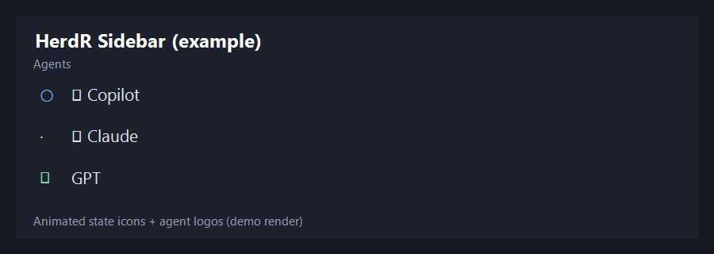
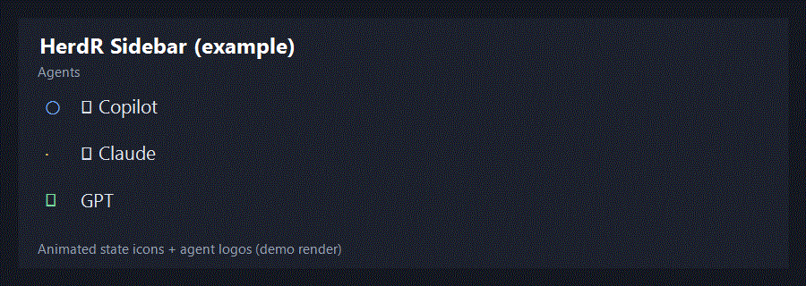

# herdr-indicators

Cross-platform HerdR state-icons plugin scaffold (Windows/macOS/Linux).

## Local dev

```bash
cd C:\Temp\DEV\herdr-indicators
herdr plugin link . --enabled
```

## Actions

- `local.state-icons.refresh`
- `local.state-icons.stop`

## Sidebar tokens

- Agent: `$state_working_line`, `$state_done_line`, `$state_blocked_line`, `$state_idle_line`, `$state_unknown_line`
- Space: `$space_working_line`, `$space_done_line`, `$space_blocked_line`, `$space_idle_line`, `$space_unknown_line`

## Configuration

Config path (after plugin link):

- Windows: `%USERPROFILE%\.config\herdr\plugins\config\local.state-icons\config.toml`
- macOS/Linux: `~/.config/herdr/plugins/config/local.state-icons/config.toml`

The plugin reads two sections:

```toml
[icons]
working = ["|", "/", "-", "\\"]
done = "+"
blocked = "!"
idle = "."
unknown = "?"
needs-input = "?"

[animation]
frame-seconds = 0.15
done-hold-seconds = 6.0
```

### Fallback vs per-agent working frames

`[icons]` is the global fallback for all statuses, and also the default `working` spinner.
`[agent-working-frames]` overrides only `working` for matching agents.

```toml
[icons]
# default spinner for unmapped agents
working = ["⠋", "⠙", "⠹", "⠸"]
# always used for non-working statuses
done = "✓"
blocked = "✗"
idle = "·"
unknown = "?"
needs-input = "?"

[agent-working-frames]
# custom working spinner for Copilot
copilot = ["○", "◎", "◉", "●"]
# custom working spinner for Claude
claude = ["·", "✢", "*", "✻", "✽"]
```

Behavior:
- Copilot/Claude in `working` -> uses `agent-working-frames`
- Any other agent in `working` -> uses `[icons].working`
- `done/blocked/idle/unknown/needs-input` -> uses `[icons]` for all agents

## Presets

- `config.example.toml`: ASCII-safe preset (works everywhere)
- `config.nerd-font.example.toml`: Nerd Font preset with a smoother spinner

To apply a preset:

```bash
copy C:\Temp\DEV\herdr-indicators\config.nerd-font.example.toml %USERPROFILE%\.config\herdr\plugins\config\local.state-icons\config.toml
herdr plugin action invoke local.state-icons.refresh
```

## Sidebar preview

Static example:



Animated example:



## License

MIT
